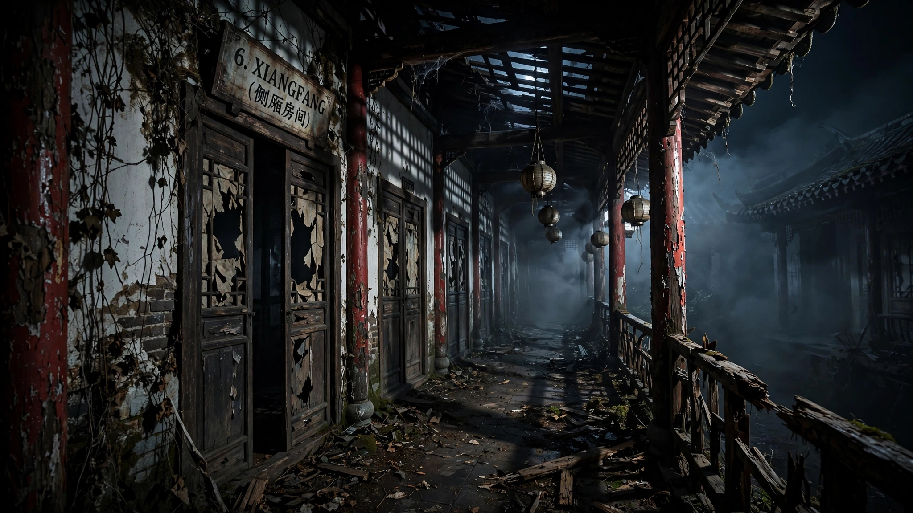

# NÃO ESTAVA AQUI ANTES

### Observe. Identifique. Sobreviva.

**Terror • Suspense • Identificação de anomalias**

**[🇧🇷 Português](#-português) · [🇺🇸 English](#-english)**

---

# 🇧🇷 Português

## 👁️ Sobre o jogo

**Não estava aqui antes** é um jogo de terror e observação no qual você precisa explorar ambientes, identificar anomalias e perceber alterações que não deveriam estar ali.

Em um mundo subterrâneo marcado por uma catástrofe, a humanidade tenta continuar existindo enquanto os mistérios da superfície começam a surgir. Sua tarefa é observar cada detalhe, reconhecer o que mudou e informar quando algo estiver errado.

> Nem tudo é o que parece. E algumas coisas simplesmente não deveriam estar ali.

## 📅 Lançamento

A publicação da versão DEMO está prevista para **7 de novembro de 2026**.

O APK ainda não está disponível neste repositório. Quando o lançamento acontecer, o arquivo será publicado na seção [Releases](../../releases).

## ⚠️ Versão DEMO

> **ATENÇÃO: ESTA É UMA VERSÃO DEMONSTRATIVA.**
>
> O jogo ainda está em desenvolvimento e pode conter bugs, falhas inesperadas, problemas de desempenho, animações incompletas e funcionalidades que poderão ser modificadas nas próximas atualizações.

O conteúdo, as mecânicas e a interface poderão mudar conforme o desenvolvimento avançar. Ao encontrar um problema, ajude o projeto registrando uma [Issue](../../issues/new/choose).

## 🎮 Informações

| Item | Informação |
|---|---|
| Título | Não estava aqui antes |
| Gênero | Terror, suspense e identificação de anomalias |
| Plataforma | Android |
| Formato de distribuição | APK |
| Estado | Demo / Em desenvolvimento |
| Lançamento previsto | 07/11/2026 |
| Engine | Godot |

## 📥 Download

<strong>Download ainda não liberado</strong>

O APK será disponibilizado nesta seção após a publicação oficial da DEMO, prevista para **7 de novembro de 2026**.

Acompanhe a página [Releases](../../releases) para encontrar o arquivo e as instruções de instalação.

## 🖼️ Screenshots

As capturas reais de gameplay serão adicionadas aqui antes ou durante o lançamento. As imagens devem representar a versão atual do jogo.

<!-- Substitua os caminhos abaixo por capturas reais do jogo quando forem adicionadas. -->
| Cena 01 | Cena 02 |
|---|---|
| *Screenshot em breve* | *Screenshot em breve* |

| Cena 03 | Cena 04 |
|---|---|
| *Screenshot em breve* | *Screenshot em breve* |

## 🐛 Encontrou um bug?

Seu relato ajuda a identificar e corrigir problemas.

[**➜ Reportar um bug**](../../issues/new?template=bug_report.yml)

Ao abrir um relato, informe:
- Modelo do dispositivo e versão do Android.
- Versão do jogo instalada.
- Passos para reproduzir o problema.
- O que você esperava que acontecesse.
- O que aconteceu de verdade.
- Screenshot ou gravação, se possível.

Não publique senhas, dados pessoais ou informações privadas.

## 🧾 Histórico de atualizações

Consulte o [CHANGELOG.md](CHANGELOG.md) para acompanhar novidades, correções e alterações de cada versão.

## 🤝 Créditos

Consulte [CREDITS.md](CREDITS.md) para conhecer as pessoas, ferramentas e recursos envolvidos no projeto.

## ⭐ Apoie o projeto

Se você gostou de **Não estava aqui antes**, considere deixar uma estrela ⭐ no repositório, compartilhar o projeto e enviar feedback construtivo.

Obrigado por jogar e ajudar no desenvolvimento!

---

# 🇺🇸 English

## 👁️ About the game

**Não estava aqui antes** is a horror and observation game where you explore environments, identify anomalies, and notice changes that should not be there.

In an underground world shaped by a catastrophe, humanity struggles to carry on as the mysteries of the surface begin to emerge. Your task is to observe every detail, recognize what has changed, and report anything unusual.

> Not everything is what it seems. Some things simply should not be there.

## 📅 Release

The DEMO release is scheduled for **November 7, 2026**.

The APK is not available in this repository yet. Once released, it will be published under [Releases](../../releases).

## ⚠️ DEMO Version

> **PLEASE NOTE: THIS IS A DEMO VERSION.**
>
> The game is still in development and may contain bugs, unexpected issues, performance problems, incomplete animations, and features that may change in future updates.

Content, mechanics, and interface elements may change as development continues. If you find a problem, please submit an [Issue](../../issues/new/choose).

## 🎮 Game information

| Item | Information |
|---|---|
| Title | Não estava aqui antes |
| Genre | Horror, suspense, anomaly observation |
| Platform | Android |
| Distribution format | APK |
| Status | Demo / In development |
| Planned release | November 7, 2026 |
| Engine | Godot |

## 📥 Download

<strong>Download not available yet</strong>

The APK will be published here after the official DEMO release, scheduled for **November 7, 2026**.

Visit [Releases](../../releases) for the file and installation instructions when it becomes available.

## 🖼️ Screenshots

Real gameplay screenshots will be added here before or during launch. Images should represent the current build of the game.

| Scene 01 | Scene 02 |
|---|---|
| *Screenshot coming soon* | *Screenshot coming soon* |

| Scene 03 | Scene 04 |
|---|---|
| *Screenshot coming soon* | *Screenshot coming soon* |

## 🐛 Found a bug?

Your report helps identify and fix problems.

[**➜ Report a bug**](../../issues/new?template=bug_report.yml)

Please include your device model, Android version, game version, reproduction steps, expected behavior, actual behavior, and screenshots or recordings when possible.

Do not post passwords, personal data, or private information.

## 🧾 Changelog

See [CHANGELOG.md](CHANGELOG.md) for new features, fixes, and changes in each release.

## 🤝 Credits

See [CREDITS.md](CREDITS.md) for project credits and acknowledgements.

## ⭐ Support the project

If you enjoy **Não estava aqui antes**, consider starring ⭐ the repository, sharing the project, and sending constructive feedback.

Thank you for playing and supporting development!

---

**NÃO ESTAVA AQUI ANTES** · Demo em desenvolvimento

Made with care using Godot.

